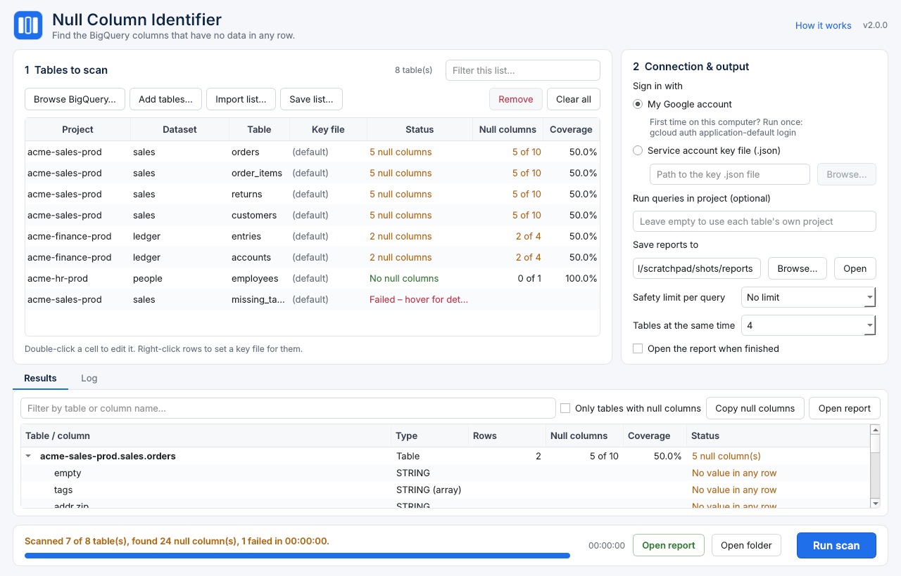
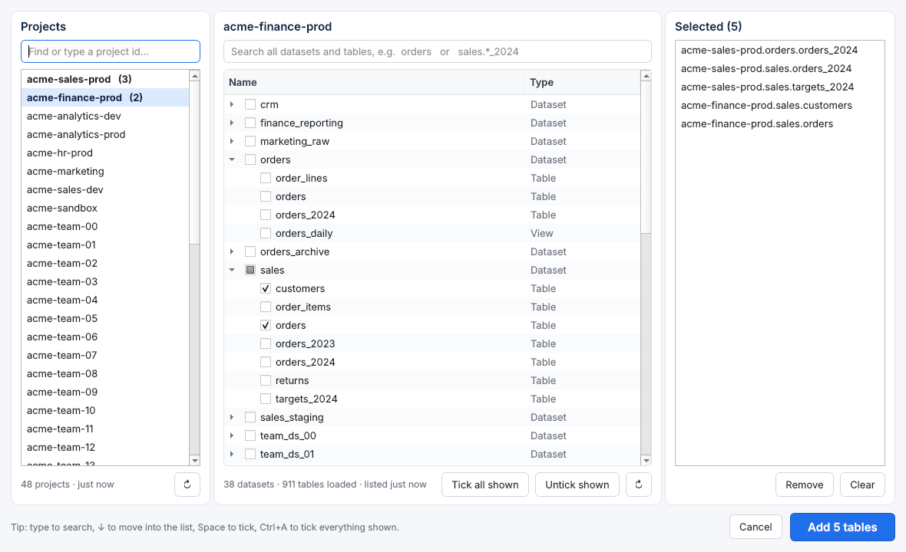

# Null Column Identifier

A desktop app that finds the columns in BigQuery tables that are **completely empty**: not a
single row has a value in them.



## Using it

1. **Add tables** in one of these ways:
   - **Browse BigQuery…**: pick projects, search, and tick datasets or single tables (see below).
   - **Add tables…** or **Ctrl+V**: paste names, one per line (`project.dataset.table`, or just
     `table` with a default project and dataset).
   - **Import list…**, or drag a file onto the list: an Excel or CSV file. The old
     `Table_name_credentials.xlsx` (sheet *Credentials* with `CredentialsAccountJson`,
     `Project_id`, `Dataset_id`, `table_id`) works as is.
2. **Choose how to sign in**:
   - *My Google account*: run `gcloud auth application-default login` once on the computer.
   - *Service account key file*: pick the `.json` key.

   A key file set on a single row (right-click → *Set key file*) overrides this, so tables
   from different projects can use different keys.
3. Optionally set a **safety limit**, so tables that are too big are skipped instead of
   billed, and choose how many **tables to scan at the same time** (default 4).
4. Click **Run scan** (F5). Only the selected rows are scanned, or the rows shown by the list
   filter, or else all rows. Progress shows per table, and **Cancel** stops the running
   queries. The window stays responsive the whole time.
5. When it finishes, the **Results** tab lists every table and its empty columns, with a
   filter and *Copy null columns*. The Excel report opens automatically.

The table list and all settings are remembered between sessions.

## Finding tables in big organisations



Browse BigQuery has three panes: **projects**, **datasets & tables** of the current project, and
the tables you've **selected**.

- **Projects**: type to filter. Recently used projects sit at the top, and each shows how
  many tables you've ticked in it. A project that isn't listed can be typed in and opened
  with Enter.
- **Search covers the whole project**: typing in the table search lists every dataset in the
  background, in parallel, so matches in datasets you haven't opened still show up. Use
  several words, which must all match, or `*` wildcards: `orders 2024`, `sales.*_2024`.
- **Tick** a table, a whole dataset (even before it has loaded), or **Tick all shown** (Ctrl+A)
  for everything the search matches. Selections stay when you switch projects, so you can
  collect tables from several projects in one go. Remove them on the right.
- **Keyboard**: Ctrl+F jumps to the table search, ↓ moves into the list, Space ticks.
- **Listings are cached on disk**, so reopening is instant even for projects with tens of
  thousands of tables. ↻ refreshes them from BigQuery. Tables already in your list are
  marked "in list".

## The report

`NullColumns_<date_time>.xlsx` in the chosen folder:

| Sheet | Contents |
|---|---|
| **Overview** | One row per table: rows, columns, null columns, coverage %, data scanned, status, link to details. Tables with no null columns are listed too (100% coverage). |
| **Null Columns** | Every empty column across all tables, ready to filter. |
| *one sheet per table* | Every column with its type, non-null row count, % filled, and result. Empty columns are highlighted. |
| **Run Info** | Who ran it, when, how long it took, totals and the definition used. |

Next to it go a `.log` file and a **PDF log**. Both start with the credits and record
**who ran it**:

- the Windows name, login and computer
- the Google account BigQuery saw (`SESSION_USER()`, which is free)
- the sign-in method and a run ID

The PDF also has a run summary, a results table, the null columns and the full log. Every
page has the credits and page numbers in the footer.

*Designed by Teja Kandukuri · Author: Balasudharam Murugesan*. These credits appear in the
app header, the About window (click the version number), the logs and the Excel *Run Info*
sheet.

## How "null" is decided

- A normal column is null when `COUNTIF(col IS NOT NULL) = 0`.
- An array column (`REPEATED`) is null when every row holds an empty array. BigQuery never
  stores a NULL array, so `IS NOT NULL` would always be true for arrays.
- A field inside a record (`addr.city`) is checked with its full path.
- A field inside a repeated record, at any depth (`items.parts.serial`), is null when no
  element in any row has a value.
- A table with 0 rows reports every column as null. The report says so.

Each table is read **once**: one query counts every column at the same time, and several
tables run in parallel. That costs the
same as `SELECT *` on the table. Very wide tables are split into batches of 400 columns. If
BigQuery rejects a batch, it is split in half until the problem column is found. That column
is reported as *Not checked* and the rest of the table still gets scanned.

## Run tracking and forced updates (admin)

Both features use two small BigQuery tables in a project you choose. Both are off until they
are set up.

**1. Create the tables (once):**

```bash
pip install -r requirements.txt
gcloud auth application-default login
python -m nci.admin setup --dataset my-admin-project.null_column_identifier
```

This creates `run_log` and `app_releases`, and writes their names into
`nci/nci_config.json`. Build the app after this, so the names are bundled into it. To see
the table definitions first, run `python -m nci.admin sql --dataset …`.

**2. Grant access**, ideally to a Google group of app users, on the dataset:

- `roles/bigquery.dataEditor` on `run_log`, so the app can record runs.
- `roles/bigquery.dataViewer` on `app_releases`, so the app can read releases.

Users don't need permission to run jobs in that project. Runs are written with the
streaming API, and releases are read with a row listing; neither starts a query.

**3. Publish a release** after sharing the new build:

```bash
python -m nci.admin release 2.3.0 --url "https://intranet/NullColumnIdentifier-2.3.0.zip" \
    --notes "Faster browse" --mandatory
python -m nci.admin list            # what's published
python -m nci.admin withdraw 2.3.0  # pull a bad release
```

The app checks at start-up and every hour (`update_check_minutes`):

- **Mandatory newer release:** a prompt shows the version, the release notes and a
  **Download** button. It can't be dismissed, and the app closes after it. If a scan is
  running, the prompt waits until the scan ends and its report is saved.
- **Optional newer release:** an "Update to x.y" button appears in the header. Nothing is
  forced.
- **Check can't run** (offline, no access, not signed in): the app keeps working. It fails
  open on purpose, so a mistake in the release table never locks everyone out.

The settings live in `nci_config.json`, which is bundled into the app. An admin can put a copy
next to the `.exe` to change a value without rebuilding. Blank values there are ignored, so
an empty file can't switch the features off. Like any check that runs on the user's own
computer, it stops casual use of old versions, not a determined user.

**Run log columns:** one row per table per run, the same figures as the Excel *Overview*
sheet:

| Column | Meaning |
|---|---|
| `run_id` | Id of the run; shared by every table scanned together |
| `execution_time` | When the run started (UTC) |
| `execution_user` | Who ran it, e.g. `Jane Doe (jdoe) on LAPTOP-42` |
| `project`, `dataset`, `table` | The scanned table |
| `status` | `Scanned`, `Failed` or `Cancelled` |
| `total_rows`, `total_columns` | Size of the table; nested fields count as columns |
| `null_columns`, `columns_with_data` | Columns with no value in any row / with at least one |
| `coverage`, `not_covered` | Percent of columns with data / null (0–100) |
| `message` | Error or note, e.g. why a table failed |
| `google_account` | Google account BigQuery saw (extra) |
| `app_version` | App version that ran it (extra; shows who still runs old versions) |

The table is partitioned by day on `execution_time` and clustered by project, dataset and
table, so the usual filters stay cheap.

```sql
-- Latest result for every table
SELECT * EXCEPT(rn) FROM (
  SELECT *, ROW_NUMBER() OVER (PARTITION BY project, dataset, `table` ORDER BY execution_time DESC) AS rn
  FROM `my-admin-project.null_column_identifier.run_log` WHERE status = 'Scanned')
WHERE rn = 1 ORDER BY null_columns DESC;

-- Runs per person per week
SELECT DATE_TRUNC(DATE(execution_time), WEEK) AS week, execution_user,
       COUNT(DISTINCT run_id) AS runs, COUNT(*) AS tables, SUM(null_columns) AS null_columns
FROM `my-admin-project.null_column_identifier.run_log`
GROUP BY week, execution_user ORDER BY week DESC, runs DESC;

-- Versions still in use (last 30 days)
SELECT app_version, COUNT(DISTINCT execution_user) AS users, MAX(execution_time) AS last_seen
FROM `my-admin-project.null_column_identifier.run_log`
WHERE execution_time > TIMESTAMP_SUB(CURRENT_TIMESTAMP(), INTERVAL 30 DAY)
GROUP BY app_version ORDER BY app_version DESC;
```

If writing a run fails, for example because the user lacks access, the run still completes
and the log notes "Run tracking skipped".

## Running from source

```bash
python -m venv .venv
.venv\Scripts\activate          # macOS/Linux: source .venv/bin/activate
pip install -r requirements.txt
python app.py                   # or: python -m nci
```

## Building the Windows app

Double-click `build_windows.bat`, or run it from a Command Prompt. It creates a virtual
environment, runs the tests, builds with PyInstaller and checks the result. Share the whole
`dist\NullColumnIdentifier` folder (zip it). Expect roughly 75–90 MB on disk, about 35 MB zipped.
The build only bundles the Qt parts the app uses and leaves out pandas, numpy and grpc. Users only run `NullColumnIdentifier.exe` and do
not need Python.

## Project layout

```
app.py                 entry point
nci/core.py            schema flattening, SQL, scanning (no UI code)
nci/report.py          Excel report
nci/catalog.py         project/dataset/table listings with disk cache
nci/identity.py        who ran it (Windows name, computer, Google account)
nci/tracking.py        run-tracking rows (one per table) and BigQuery schema
nci/releases.py        versions, release table, update decision
nci/config.py          admin settings (nci_config.json)
nci/admin.py           admin tool: setup, release, withdraw, list, sql
nci/gui/pdflog.py      PDF log
nci/inputs.py          import/export of table lists
nci/gui/               PySide6 desktop interface
tests/                 tests, with a fake BigQuery client
```

Run the tests with `pip install -r requirements-dev.txt` and then `pytest`.
